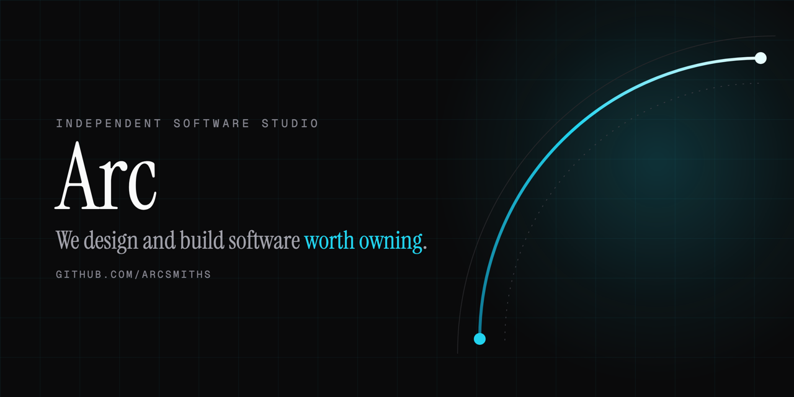

  

  <strong>Arc</strong> is an independent software studio. We design and build web, mobile, 
  and platform products end to end — from the first sketch to production. We also build our own.

  <a href="https://arcsmiths.com"><strong>arcsmiths.com</strong></a>
  &nbsp;·&nbsp;
  <a href="mailto:hello@arcsmiths.com">hello@arcsmiths.com</a>

---

### What we build

- **Web** — Next.js, Astro · SSR storefronts, dashboards, marketing sites
- **Mobile** — Flutter · iOS + Android from one codebase
- **Platforms & APIs** — NestJS, PostgreSQL · multi-tenant backends built to scale
- **Commerce** — custom Shopify & headless · Stripe payments
- **POS integrations** — Square, Toast, Clover
- **AI & computer vision** — facial recognition, liveness / anti-spoofing, on-device inference

### Products

- **[Keepfork](https://keepfork.app)** — a white-label ordering platform that gives restaurants
  and retailers their own branded storefront, without the 15–30% fees. _In development._
- …plus general software and client work. More in the works.

### Toolkit

ArcSmiths · Independent Software Studio
